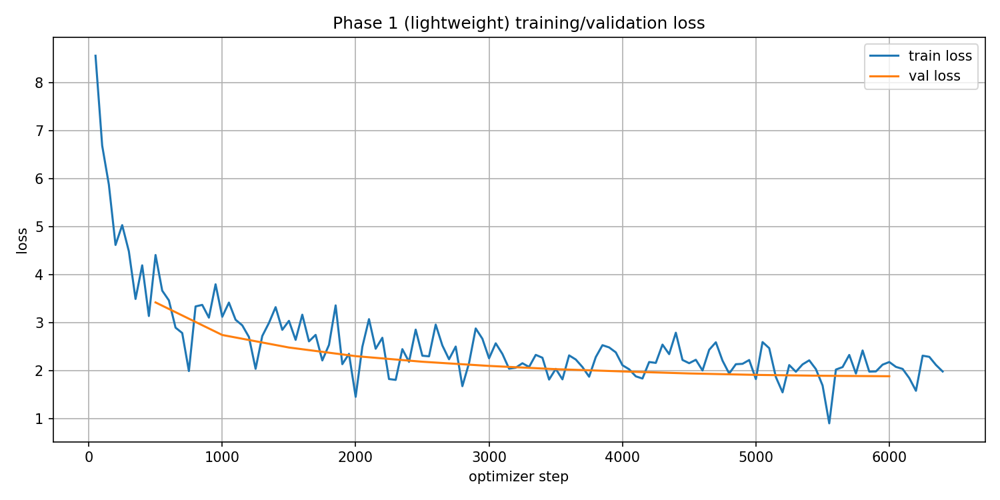

# CS781 Capstone — In-House Legal Foundation LLM Stack

**Course:** CS781 — Large Language Models (IIT Kanpur)  
**Advisor:** Prof. Ashutosh Modi  
**Author:** Khush Maheshwari (`khushmahes23@iitk.ac.in`)

An end-to-end **from-scratch legal foundation LLM stack** built strictly with `torch.nn` (zero pretrained Hugging Face weights, zero external LLM APIs) for confidential, self-hosted legal workflows. Across **7 phases**, four custom Transformer architectures are pretrained on a legal corpus with a custom 32k BPE tokenizer and adapted to **6 downstream Indian/legal NLP benchmarks** using **9 adaptation and compression methods**.

---

## End-to-End Benchmark Summary (Phases 1–7)

| Phase | Task | Adaptation Methods Explored | Best Run | Key Metric | Artifacts |
| :---: | :--- | :--- | :--- | :--- | :---: |
| **1** | **Legal LM Pretraining** | 4 custom architectures from scratch (`Decoder-Only`, `Encoder-Decoder`, `Hybrid Prefix-LM`, `Lightweight`) | `run_lightweight` | **0.8309 BERTScore F1** *(Official Codabench, Rank 75, 1,000 examples)* | [Code](Phase1/) · [Results](results/phase1/) |
| **2** | **Legal NER** *(12 entity classes)* | Full FT, Partial FT, BitFit, LoRA, LoRMA+, KD *(14 runs)* | `decoder_full_v4` / `lightweight_kd_v3` | **0.4805** strict dev macro-F1 *(KD student: **0.4616**, 96% retention)* | [Code](Phase2/) · [Results](results/phase2/) |
| **3** | **Rhetorical Role Prediction** *(CL & IT, 13 labels)* | Full FT, LoRA, rsLoRA, LoRMA+, IA³, KD + context ablations *(8 runs)* | `lightweight_kd_kd_context2` | **0.4411** combined dev macro-F1 *(LoRMA+: **0.4157** at 1.58M params)* | [Code](Phase3/) · [Results](results/phase3/) |
| **4** | **Court Judgment Prediction (CJPE)** | Full FT, Partial FT, BitFit, Residual Adapters, LoRMA+, KD *(6 runs)* | `lightweight_lorma_v1` | **0.6823** dev macro-F1 *(**+3.1 pp** vs. Full FT `0.6517`)* | [Code](Phase4/) · [Results](results/phase4/) |
| **5** | **Statute Identification** *(Multi-label)* | Full FT, Partial FT, Residual Adapters, LoRMA+, KD *(6 runs)* | `lightweight_kd_v1` | **0.3835** dev macro-F1 / **0.4741** micro-F1 | [Code](Phase5/) · [Results](results/phase5/) |
| **6** | **Legal Summarization** *(351 held-out docs)* | Full FT, LoRA, LoRMA+, Houlsby Adapters, Soft Prompt Tuning, KD *(6 runs)* | `decoder_lora_v1` | **0.8392** BERTScore F1 / **0.3379** ROUGE-1 / **0.1909** ROUGE-L | [Code](Phase6/) · [Results](results/phase6/) |
| **7** | **Prior Case Retrieval** *(118 queries)* | Full FT, Partial FT, LoRMA+, IA³, Soft Prompt, KD + BM25 rank fusion *(7 runs)* | `lightweight_kd_v1` | **0.2446** dev Micro-F1@7 *(**2.06×** BM25 baseline `0.1190`; exact official match)* | [Code](Phase7/) · [Results](results/phase7/) |

> **Note:** Phase 1 & Phase 7 include verified Codabench submission matches; Phases 2–6 report held-out validation/development selection metrics exported with full run configs, histories, and verification manifests inside `results/`.

---

## Key Research & Engineering Highlights

1. **Four Distinct From-Scratch Transformer Architectures (`Phase 1`):**
   - Implemented entirely in native PyTorch (`torch.nn`) with a custom legal BPE tokenizer:
     - **Decoder-Only Transformer** (`~110M` params)
     - **Encoder-Decoder Transformer**
     - **Hybrid Prefix-LM**
     - **Lightweight / Efficient Transformer** (`~64M` params — **38% smaller** than the 110M decoder backbone)
2. **Comprehensive PEFT & Adaptation Study (`Phases 2–7`):**
   - Systematically benchmarked **Full Fine-Tuning**, **Partial Fine-Tuning**, **LoRA**, **rsLoRA**, **LoRMA+**, **IA³**, **BitFit**, **Houlsby / Residual Bottleneck Adapters**, **Soft Prompt Tuning**, and **Knowledge Distillation** under shared evaluation protocols.
   - In **Phase 4 (CJPE)**, `LoRMA+` on the lightweight backbone outperformed 110M Full Fine-Tuning by **+3.1 percentage points** (`0.6823` vs `0.6517` macro-F1).
3. **Lightweight Knowledge Distillation Wins Locally:**
   - The **64M lightweight backbone** (pretrained or distilled) achieved the top recorded local score in **5 of 7 phases** (Phases 1, 3, 4, 5, and 7), retained **96%** of full-FT strict NER F1 in Phase 2 (`0.4616` vs `0.4805`), and reached `0.8366` BERTScore F1 in Phase 6 summarization.
4. **Reproducible Modular Pipeline & Audit Trail:**
   - Every phase includes a standalone Colab notebook (`solution.ipynb` / `CS781_Phase7_Solution_Colab.ipynb`), modular Python source files (Phases 5–7), automated notebook validators (`validate_phase*_notebook.py`), and structured JSON/CSV result ledgers under `results/`.

---

## Phase-by-Phase Breakdown

### Phase 1 — Legal Language Model Pretraining ([`Phase1/`](Phase1/) · [`results/phase1/`](results/phase1/))
- Pretrained 4 custom Transformer architectures from scratch on the official CS781 legal corpus (`Exploration-Lab/CS-781-Capstone`).
- **Official Best Submission (`run_lightweight`):** **0.8309 BERTScore F1**, **0.1907 ROUGE-L F1**, **0.0398 BLEU-4** across 1,000 examples (Codabench Rank 75).

<p align="center">
  
</p>

### Phase 2 — Legal Named Entity Recognition ([`Phase2/`](Phase2/) · [`results/phase2/`](results/phase2/))
- Token-level legal NER across **12 entity classes** (14 saved runs across `v1`–`v4` configs, class-weighted losses, and constrained decoding).
- Best strict validation macro-F1: **`decoder_full_v4` (0.4805)**, followed closely by **`lightweight_kd_v3` (0.4616)** and **`lightweight_lorma_v3` (0.3896)** with only `388K` trainable parameters.

### Phase 3 — Rhetorical Role Prediction ([`Phase3/`](Phase3/) · [`results/phase3/`](results/phase3/))
- Sentence-level rhetorical role classification across **13 labels** spanning **CL** and **IT** legal domains, preserving document order and ablating surrounding sentence context (`context=1` vs. `context=2`).
- Expanding context + knowledge distillation (`lightweight_kd_kd_context2`) lifted combined dev macro-F1 from `0.3728` to **0.4411** (`0.4451` IT, `0.3268` CL).

### Phase 4 — Court Judgment Prediction & Explanation ([`Phase4/`](Phase4/) · [`results/phase4/`](results/phase4/))
- Whole-case binary judgment prediction with dev-calibrated decision thresholds across 6 adaptation strategies.
- Best dev macro-F1: **`lightweight_lorma_v1` (0.6823)** (Class-1 precision `0.7031`, recall `0.6338`), outperforming Full FT (`0.6517`), Residual Adapters (`0.6430`), and BitFit (`0.6063`).

### Phase 5 — Statute Identification ([`Phase5/`](Phase5/) · [`results/phase5/`](results/phase5/))
- Multi-label statute prediction from legal case facts with modular data/loss/metrics/control pipelines.
- Best dev score: **`lightweight_kd_v1` (0.3835 macro-F1, 0.4741 micro-F1)**, outperforming Full FT (`0.3673` macro-F1) and Residual Adapters (`0.3535`).

### Phase 6 — Legal Document Summarization ([`Phase6/`](Phase6/) · [`results/phase6/`](results/phase6/))
- Abstractive legal summarization (640-token source budget, 256-token generation) evaluated across **351 held-out documents** using `roberta-large` BERTScore and stemmed ROUGE.
- Best held-out score: **`decoder_lora_v1` (0.8392 BERTScore F1, 0.3379 ROUGE-1, 0.1909 ROUGE-L)**, closely followed by **`lightweight_kd_v1` (0.8366 BERTScore F1)**.

### Phase 7 — Prior Case Retrieval ([`Phase7/`](Phase7/) · [`results/phase7/`](results/phase7/))
- Dense neural retrieval + BM25 rank fusion and late-interaction policies over **118 dev queries** and the full candidate case pool.
- Best dev score & exact official submission match: **`lightweight_kd_v1` (0.2446 fused Micro-F1@7 / 0.2112 dense-only)**, more than **doubling the BM25 lexical baseline (`0.1190`)**.

---

## Repository Structure

```text
├── Phase1/                 # From-scratch BPE + 4 Transformer pretraining notebooks
├── Phase2/                 # Legal NER notebook, builder & validation scripts
├── Phase3/                 # Rhetorical Role Prediction (CL & IT) notebook & validators
├── Phase4/                 # Court Judgment Prediction (CJPE) notebook & validators
├── Phase5/                 # Statute Identification (modular Python + notebook + TUNING/VALIDATION docs)
├── Phase6/                 # Legal Summarization (modular generation/training/metrics + notebook)
├── Phase7/                 # Prior Case Retrieval (dense + BM25 fusion + Colab notebook)
└── results/
    ├── phase1/             # Pretraining loss curves, official Codabench match & manifests
    ├── phase2/ ... phase7/ # Per-run configs, metrics JSONs, histories, training curves & summaries
```

---

## Reproducibility & Usage

1. Open any phase notebook (e.g., `Phase1/solution.ipynb` or `Phase7/CS781_Phase7_Solution_Colab.ipynb`) in **Google Colab** with a GPU runtime.
2. Add your Hugging Face token as a Colab secret named `HF` (used strictly to download the official `Exploration-Lab/CS-781-Capstone` competition datasets).
3. Run Phase 1 first to produce `bpe_tokenizer/` and the four `run_<architecture>/final_model.pt` checkpoints; Phases 2–7 load those Phase 1 checkpoints directly from Drive.
4. *(Optional)* Run `python PhaseX/validate_phaseX_notebook.py` locally to verify notebook structure and schema integrity.

> Large model checkpoints (`*.pt`) and Codabench submission archives (`*.zip`) are intentionally excluded from Git; full experiment metadata, hyperparameters, plots, and metric logs are preserved in `results/`.

---

## Tech Stack

`Python` · `PyTorch (torch.nn)` · `Custom BPE Tokenization` · `PEFT (LoRA, rsLoRA, LoRMA+, IA³, BitFit, Adapters, Prompt Tuning)` · `Knowledge Distillation` · `BM25 + Dense Retrieval Fusion` · `BERTScore / ROUGE`
